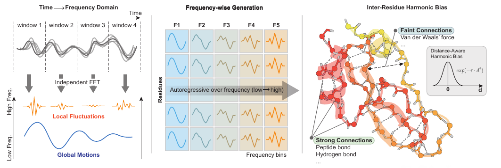
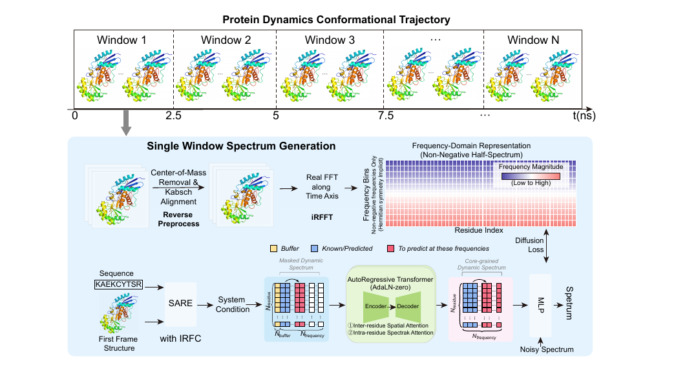

# BioDynaSpec: Harmonic-Guided Spatio-Spectral Autoregressive Diffusion for Protein Dynamics Generation

<p align="center">
  <strong>ICML 2026 Submission</strong>
</p>

<p align="center">
  <a href="#abstract">Abstract</a> •
  <a href="#motivation">Motivation</a> •
  <a href="#method">Method</a> •
  <a href="#installation">Installation</a> •
  <a href="#data-preparation">Data Preparation</a> •
  <a href="#training">Training</a> •
  <a href="#inference">Inference</a> •
  <a href="#results">Results</a> •
  <a href="#project-structure">Project Structure</a> •
  <a href="#citation">Citation</a>
</p>

---

## Abstract

Generating long-horizon, all-atom molecular dynamics (MD) is difficult due to error accumulation in time-domain autoregressive models (causing drift) and fixed step-size constraints on temporal resolution. We propose **BioDynaSpec**, which reformulates protein dynamics as spatio-spectral generation: **Independent Windowed Fourier Decomposition (IWFD)** decomposes trajectories into independent windowed frequency representations, and a generator combines low-to-high frequency autoregression with diffusion denoising to reconstruct continuous motion. We introduce **Inter-Residue Frequency Coupling (IRFC)** bias, a learnable Gaussian distance bias in attention that injects a resonance-inspired structural prior to stabilize training and improve cross-residue, cross-frequency consistency. On ATLAS, BioDynaSpec improves 250-frame trajectory generation with \(R_{250}=1.509\) Å (where \(R_s\) denotes the mean per-frame Cα-RMSE over the first \(s\) frames after alignment), reducing error by 60.4% vs. MDGEN and 57.2% vs. ProAR, and achieves the best PCA-2D displacement-profile correlation and stepwise distribution matching. For equilibrium conformational sampling, it achieves Root Mean \(W_2=1.31\), MD PCA \(W_2=0.90\), and Joint PCA \(W_2=1.19\) (50.03%, 35.25%, and 47.58% lower than the next best), while ablations show removing IRFC severely degrades RMSE/MAE and correlation.

---

## Motivation

Time-domain autoregressive models for protein dynamics suffer from cumulative error drift and are locked to a fixed temporal step size. BioDynaSpec addresses these fundamental limitations by operating in the **frequency domain**: trajectories are decomposed via windowed Fourier transforms, and generation proceeds from low to high frequencies—naturally capturing the hierarchy of protein motions from slow collective modes to fast local fluctuations.

<p align="center">
  
</p>

**Figure 1.** Motivation for spectral-domain protein dynamics generation. Time-domain autoregressive models accumulate errors over long horizons, while frequency-domain generation via IWFD decouples temporal resolution from step count and naturally respects the multi-scale nature of protein motions.

---

## Method

BioDynaSpec consists of three core components:

1. **Independent Windowed Fourier Decomposition (IWFD):** Decomposes all-atom MD trajectories into independent windowed frequency representations, enabling parallel generation across windows and decoupling temporal resolution from the number of generation steps.

2. **Spatio-Spectral Autoregressive Diffusion:** A hybrid generator that autoregressively predicts frequency components from low to high, using diffusion-based denoising at each step to produce high-fidelity spectral coefficients.

3. **Inter-Residue Frequency Coupling (IRFC):** A learnable Gaussian distance bias injected into the attention mechanism, providing a resonance-inspired structural prior that enforces cross-residue, cross-frequency consistency and stabilizes training.

<p align="center">
  
</p>

**Figure 2.** Overview of the BioDynaSpec architecture. (Left) IWFD decomposes trajectories into windowed frequency representations. (Center) The autoregressive diffusion generator predicts spectral coefficients from low to high frequency. (Right) IRFC injects structural priors via learnable Gaussian distance biases in attention.

---

## Installation

### Prerequisites

- **OS:** Linux (tested on Ubuntu 20.04/22.04)
- **GPU:** NVIDIA GPU with CUDA 12.4+ support (tested on A800, H200)
- **Python:** 3.11+
- **Conda:** Miniconda or Anaconda

### Step 1: Clone the Repository

```bash
git clone https://github.com/anonymous/BioDynaSpec.git
cd BioDynaSpec
```

### Step 2: Create Conda Environment

We provide a comprehensive dependency installation script:

```bash
bash dependencies.sh
```

This will:
1. Create a conda environment named `torch` with Python 3.11
2. Install system dependencies (GCC 13.3, OpenBLAS)
3. Install PyTorch 2.6.0 with CUDA 12.4
4. Install all required Python packages

### Step 3: Activate Environment

```bash
conda activate torch
```

### Key Dependencies

| Package | Version | Purpose |
|---------|---------|---------|
| PyTorch | 2.6.0 | Deep learning framework |
| PyTorch Lightning | 2.5.1 | Training framework |
| Flash Attention 2 | latest | Efficient attention |
| DeepSpeed | 0.16.5 | Distributed training |
| Ray Tune | 2.51.1 | Hyperparameter optimization |
| MDAnalysis | latest | MD trajectory I/O |
| fair-esm | latest | ESM protein embeddings |
| WandB | ≥0.12.10 | Experiment tracking |
| RDKit | 2025.3.6 | Molecular processing |
| Biotite | 1.2.0 | Structural biology toolkit |

### Optional: WandB Setup

If you want experiment tracking with Weights & Biases:

```bash
export WANDB_API_KEY="your_api_key_here"
# Or login interactively:
wandb login
```

To disable WandB, set `use_wandb: false` in the config YAML.

---

## Data Preparation

BioDynaSpec is evaluated on the [ATLAS](https://www.dsimb.inserm.fr/ATLAS/) dataset of
all-atom MD simulations. Below is the **complete** path from raw ATLAS downloads to the
tensors that `scripts/pretrain.sh` reads. Every stage is driven by one script:

```bash
bash scripts/generate_data.sh --all          # run everything, start to finish
bash scripts/generate_data.sh --all --dry-run # show the plan, run nothing
bash scripts/generate_data.sh --stage assemble --stage normalize  # just re-run two stages
```

`generate_data.sh` locates the `torch` conda env itself, so it works from a shell where
nothing is activated. Override any path with an environment variable (see the CONFIG block
at the top of the script).

### Pipeline overview

```
                     raw ATLAS (.tpr/.xtc)
                              │
        ┌─────────────────────┴──────────────────────┐
        │ Stage 1  extract_frames                    │  Cα only (paper Sec. 3.1)
        ▼                                            │
   <ID>_frames_coords.npy  (T, N_res, 3)             │
        │                                            │
        │   mmCIF ──► Stage 2  prepare_md_training_data
        │                    ├─ bioassembly/<pdb>.pkl.gz   (rotation matrices, aatype)
        │                    ├─ sequences/pdb_seq.csv
        │                    └─ indices/atlas_traj_indices.csv
        │                                            │
        │              Stage 3  compute_esm           │
        │                    └─ esm_cache/<shard>/<pdb>_<ent>.pt  (N_res, 1280)
        │                                            │
        └───────────────► Stage 4  assemble_training_dataset.py
                              └─ atlas_10_features_fouriered_list_{train,val,test}.pth
                                     │
                              Stage 5  compute_fft_window_scaling.py
                                     └─ *_normalized.pth  +  *_scaling_factors.pth
                                     │
                              scripts/pretrain.sh
```

Two stages deserve emphasis, because they are the ones most often missing when someone
tries to reproduce this pipeline:

* **Stage 4 (assemble)** is what turns per-trajectory arrays into the *list of per-protein
  dicts* that the dataset classes actually index. Nothing downstream of it can run without
  it: `replace_positions_full_fft_atlas.py` and `compute_fft_window_scaling.py` only
  *transform* an existing `.pth`, they never create one.
* **Stage 5 (normalize)** is what computes the per-frequency scale factors `s_f`
  (95th percentile of coefficient magnitudes, **training split only**) and applies them —
  the `~/s_f` normalization in paper Eq. (7)/(17).

### Stage 0 — download ATLAS metadata + mmCIF *(optional, network)*

```bash
export ATLAS_CSV_PATH=./data/raw_data/ATLAS.csv   # ATLAS metadata table
export MMCIF_DIR=./data/mmcifs                    # where mmCIF structures land
bash scripts/generate_data.sh --stage download
```
Skip this if you already have the mmCIFs; the raw `.tpr/.xtc` trajectories come from the
[ATLAS website](https://www.dsimb.inserm.fr/ATLAS/) directly.

### Stage 1 — extract Cα frames from raw trajectories

Expects `$ATLAS_RAW_DIR/<pdb>_<chain>/total/<pdb>_<chain>_prod_<R1|R2|R3>.{tpr,xtc}`
and writes `$TRAJ_DIR/<ID>_<R#>/<ID>_<R#>_ca_frames_coords.npy` of shape `(T, N_res, 3)`.

```bash
export ATLAS_RAW_DIR=./data/raw_data/ATLAS
export TRAJ_DIR=./data/trajectories/atlas
bash scripts/generate_data.sh --stage extract
```

> **The extraction is Cα-only, and that is deliberate.** BioDynaSpec is a residue-level
> model: `USE_CA_ONLY = True` in
> `runner/data_prepare/extract_frames/save_frames_to_npy_atlas.py`, so `N` is the residue
> count and `x_t ∈ R^{N_r×3}` exactly as in paper Sec. 3.1 / Eq. (1). Set it to `False`
> only if you deliberately want multi-atom frames — the rest of the pipeline assumes one
> representative atom per residue, and `replace_positions_full_fft_atlas.py` defaults to
> `--atom_selection "name CA"` for the same reason.

### Stage 2 — bioassembly + sequence/trajectory indices

Turns the mmCIF structures into the per-PDB metadata (backbone rotation matrices, amino-acid
types) and writes the trajectory index CSV that Stage 4 consumes.

```bash
bash scripts/generate_data.sh --stage features
```
Produces:
* `$BIOASSEMBLY_DIR/<pdb>.pkl.gz` — rotation matrices, aatype, atom metadata
* `$SEQ_INDEX_DIR/pdb_seq.csv` — sequences (input to Stage 3)
* `data/indices/atlas_traj_indices.csv` — columns `traj_name,pdb_name`

### Stage 3 — ESM-2 embeddings

BioDynaSpec conditions on **ESM-2-650M** (1280-d) embeddings, matching paper Sec. 4.2.

```bash
export ESM_MODEL_NAME=esm2-650m          # 1280-d. Do NOT use esm2-3b (2560-d).
bash scripts/generate_data.sh --stage esm
```

> **Dimension trap.** `configs/configs_model.py` also lists `esm2-3b`, which is **2560-d**.
> The model config (`esm_dim: 1280`), `featureextractor.py`, and `protein_spectrum_far.py`
> all hard-code 1280, so a 3B cache will not load. The script warns if you select it.

### Stage 4 — assemble the training dataset

```bash
bash scripts/generate_data.sh --stage assemble
```

Joins frames + bioassembly + ESM into `List[dict]` and writes
`$DATASET_DIR/fft_window<W>/atlas_10_features_fouriered_list_{train,val,test}.pth`,
one entry per trajectory:

| key | type / shape | meaning |
|---|---|---|
| `id` | `str` | e.g. `16pk_A_R1` |
| `amino_acid_types` | `LongTensor (N,)` | 0–19, non-standard → 20 |
| `rotation_matrices0` | `FloatTensor (N,3,3)` | backbone frames from the bioassembly |
| `esm` | `FloatTensor (N,1280)` | ESM-2-650M per residue |
| `positions.x/y/z` | `list[N]` of `ndarray (F,2)` | full-trajectory rFFT half-spectrum |
| `positions.x0/y0/z0` | `ndarray (N,)` | anchor frame (aligned frame 0) |
| `positions.x_fft_windows` | `list[n_win]` of `list[N]` of `ndarray (F,2)` | **what training iterates over** |
| `positions.x0_fft_windows` | `list[n_win]` of `ndarray (N,)` | per-window anchor |
| `positions.fft_window_size` | `int` | `W` (2500) |
| `positions.fft_hop_ratio` | `float` | `1.0` = non-overlapping (paper §IWFD) |
| `positions.preprocess_state_fft_windows` | `list[dict]` | COM removal + Kabsch transform, for inverting alignment |

Key defaults: `--window_size 2500`, `--hop_ratio 1.0` (**non-overlapping**, as the paper
requires), `--dt_str 10ps`, `--esm_dim 1280`, `--ratios 0.93/0.03/0.04` (the paper's
1269/39/82 split), `--max_residues 1000` (matches the trainer's own length filter).

For very large runs use `--shard_size N` to write shards instead of one multi-GB file.

### Stage 5 — per-frequency scaling and normalization

```bash
bash scripts/generate_data.sh --stage normalize
```

Computes `s_f` as the 95th percentile of `|S_f|` over the **training split only**, then
divides every coefficient by `s_f` (paper Eq. 7). Writes:

```
$DATASET_DIR/fft_window2500/
├── atlas_10_features_fouriered_list_{train,val,test}.pth              # unnormalized
├── atlas_10_features_fouriered_list_{train,val,test}_normalized.pth   # <- training reads these
└── fft_window2500_scaling_factors.pth                                 # s_f
```

With `W = 2500` the half-spectrum has `F = ⌊W/2⌋ + 1 = 1251` non-negative bins, which is
what paper Eq. (2) and the `--num_freq 1251` default encode.

### Expected final layout

```
dataset/                          # configs point at ./dataset/... (symlink it if needed)
├── fft_window2500/
│   ├── atlas_10_features_fouriered_list_train_normalized.pth
│   ├── atlas_10_features_fouriered_list_val_normalized.pth
│   ├── atlas_10_features_fouriered_list_test_normalized.pth
│   └── fft_window2500_scaling_factors.pth
├── bioassembly/atlas/            # Stage 2
├── sequences/                    # Stage 2
└── esm_cache/esm2_650m_embed/    # Stage 3
```

Then train:

```bash
bash scripts/pretrain.sh --config configs/trainer_BioDynaSpec.yaml
```

---

## Training

### Single-GPU Training

```bash
bash scripts/pretrain.sh --config configs/trainer_BioDynaSpec.yaml
```

### Multi-GPU Distributed Training

```bash
NUM_GPUS=8 bash scripts/pretrain.sh --config configs/trainer_BioDynaSpec.yaml
```

### Resume from Checkpoint

```bash
bash scripts/pretrain.sh \
    --config configs/trainer_BioDynaSpec.yaml \
    --resume /path/to/checkpoint.ckpt
```

### Configuration

All training hyperparameters are defined in YAML configuration files under `configs/`:

| Config File | Description |
|-------------|-------------|
| `configs/trainer_BioDynaSpec.yaml` | **Full model** with IRFC (recommended) |
| `configs/trainer_BioDynaSpec_wo_irfc.yaml` | Ablation: without IRFC |
| `configs/trainer_far_example.yaml` | Example/template config |

**Key hyperparameters** (in `configs/trainer_BioDynaSpec.yaml`):

```yaml
# Model
with_irfc: true                 # Enable IRFC structural bias
use_complex_spectrum: true      # Complex-valued spectrum
num_sampling_steps: '50'        # Diffusion sampling steps
diffusion_steps: 1000           # Total diffusion timesteps
noise_schedule: 'cosine'        # Noise schedule type
max_spectrum_len: 2560          # Maximum frequency length

# Training
max_epochs: 50
lr: 0.0001
warmup_epochs: 10
precision: 'bf16'               # Mixed precision training
gradient_clip_val: 1.0
enable_spectrum_chunk_loss: true # Spectral consistency loss
```

Configuration priority: **command-line arguments > YAML config > `BaseConfig` defaults**.

### Hyperparameter Search with Ray Tune

```bash
bash scripts/ray_tune.sh
```

This uses Ray Tune with ASHA scheduling for efficient hyperparameter optimization. Results are saved to `./runs_ray_tune/`.

### Training Outputs

Training checkpoints and logs are saved to:

```
runs/
└── BioDynaSpec_<timestamp>/
    ├── checkpoints/
    │   ├── last.ckpt
    │   └── epoch=XX-train_loss=X.XX.ckpt
    └── wandb/   # if WandB is enabled
```

---

## Inference

### Generate Trajectories

```bash
bash scripts/inference.sh \
    --checkpoint runs/BioDynaSpec_<timestamp>/checkpoints/last.ckpt \
    --data dataset/fft_window2500/atlas_10_features_fouriered_list_test_normalized.pth \
    --output_dir runs/inference_output
```

### Full Inference Options

```bash
bash scripts/inference.sh \
    --checkpoint /path/to/checkpoint.ckpt \
    --data /path/to/test_data.pth \
    --output_dir /path/to/output \
    --data_mode fft_window \
    --window_size 2500 \
    --num_samples 1 \
    --num_frames 2500 \
    --seed 42 \
    --device cuda
```

### Inference Parameters

| Parameter | Default | Description |
|-----------|---------|-------------|
| `--checkpoint` | (required) | Path to trained model checkpoint |
| `--data` | `dataset/.../test_normalized.pth` | Test dataset path |
| `--output_dir` | `runs/inference_output` | Output directory |
| `--data_mode` | `fft_window` | Data mode (`fft_window`) |
| `--window_size` | `2500` | FFT window size |
| `--num_samples` | `1` | Number of samples per protein |
| `--num_frames` | `2500` | Number of trajectory frames to generate |
| `--seed` | `42` | Random seed |
| `--device` | `cuda` | Device (`cuda` or `cpu`) |

### Inference Outputs

```
runs/inference_output/
├── reconstructed_trajs/        # Generated PDB trajectories
│   ├── protein_0/
│   │   ├── frame_0000.pdb
│   │   ├── frame_0001.pdb
│   │   └── ...
│   └── ...
├── metrics.json                # Quantitative evaluation metrics
└── inference_<timestamp>.log   # Inference log
```

---

## Results

### Trajectory Generation (ATLAS, 250 frames)

| Method | \(R_{250}\) (Å) ↓ | PCA-2D Corr ↑ | Stepwise Dist ↓ |
|--------|:---:|:---:|:---:|
| MDGEN | 3.810 | — | — |
| ProAR | 3.526 | — | — |
| **BioDynaSpec** | **1.509** | **Best** | **Best** |

**BioDynaSpec** reduces trajectory RMSE by **60.4%** vs. MDGEN and **57.2%** vs. ProAR.

### Equilibrium Conformational Sampling

| Method | Root Mean \(W_2\) ↓ | MD PCA \(W_2\) ↓ | Joint PCA \(W_2\) ↓ |
|--------|:---:|:---:|:---:|
| Next Best | 2.62 | 1.39 | 2.27 |
| **BioDynaSpec** | **1.31** | **0.90** | **1.19** |
| Improvement | 50.03% | 35.25% | 47.58% |

### Ablation Study

| Variant | Effect |
|---------|--------|
| Full model (w/ IRFC) | Best overall performance |
| w/o IRFC | Severely degrades RMSE/MAE and correlation |
| w/o Spectrum Chunk Loss | Reduced spectral consistency |

To reproduce the ablation without IRFC:

```bash
bash scripts/pretrain.sh --config configs/trainer_BioDynaSpec_wo_irfc.yaml
```

---

## Project Structure

```
BioDynaSpec/
├── README.md                          # This file
├── dependencies.sh                    # Environment setup script
│
├── configs/                           # Configuration files
│   ├── trainer_BioDynaSpec.yaml       # Full model config (with IRFC)
│   ├── trainer_BioDynaSpec_wo_irfc.yaml # Ablation config (without IRFC)
│   ├── trainer_far_example.yaml       # Example/template config
│   ├── configs_data.py                # Data path configuration
│   ├── configs_model.py               # ESM model registry (ESM_CONFIG)
│   └── config_utils.py                # Env-backed config helpers
│
├── scripts/                           # Launch scripts
│   ├── pretrain.sh                    # Training launcher
│   ├── inference.sh                   # Inference launcher
│   ├── generate_data.sh              # Data generation pipeline
│   └── extract_frames.sh             # Frame extraction from MD
│
├── src/                               # Source code
│   ├── trainer_far.py                 # PyTorch Lightning training loop
│   ├── protein_spectrum_far.py        # Core FAR model (encoder + decoder)
│   ├── main_model.py                  # Model wrapper + LR scheduler
│   ├── inferencer_far.py              # Inference engine
│   ├── featureextractor.py            # Protein feature extraction
│   │
│   ├── model/                         # Model components
│   │   ├── diffloss.py                # Diffusion loss (SpectrumDiffLoss)
│   │   ├── diffusion/                 # Diffusion modules
│   │   │   ├── gaussian_diffusion.py  # Gaussian diffusion process
│   │   │   ├── denoise_net.py         # SpectralDiT denoising network
│   │   │   ├── respace.py             # Diffusion step respacing
│   │   │   └── diffusion_utils.py     # Diffusion utilities
│   │   ├── loss/                      # Loss functions
│   │   │   └── spectrum_loss.py       # SpectrumChunkLoss
│   │   └── modules/                   # Neural network modules
│   │       ├── transformer.py         # Diffusion Transformer (adapted from
│   │       │                          #   AlphaFold3/Protenix; holds the IRFC bias)
│   │       └── primitives.py          # Basic building blocks
│   │
│   ├── data/                          # Data processing
│   │   ├── fourier/                   # Fourier transform utilities
│   │   │   └── utils.py              # IWFD implementation
│   │   └── basic/                     # Basic data utilities
│   │       └── compute_esm.py         # ESM embedding computation
│   │
│   ├── openfold_local/                # Local OpenFold modules (IPA, triangular attn)
│   ├── protenix/                      # Local Protenix modules
│   ├── utils/                         # General utilities
│   └── visualize/                     # Visualization tools
│
├── runner/                            # Data preparation runners
│   └── data_prepare/
│       ├── assemble_training_dataset.py         # Builds the *.pth data_list
│       ├── replace_positions_full_fft_atlas.py  # IWFD preprocessing
│       ├── compute_fft_window_scaling.py        # Scaling factor computation
│       ├── download_atlas_cifs.py               # ATLAS data download
│       ├── extract_frames/                      # Frame extraction
│       ├── 2_prepare_data/                      # Data cleaning
│       └── 4_compute_esm/                       # ESM computation
│
├── evaluation/                        # Model-independent metrics (see its README)
│   ├── metrics/
│   │   ├── trajectory.py              # Kabsch RMSD / RMSF primitives
│   │   ├── analyze_ensembles.py       # PCA-W2, EMD, contact prob, SASA/MI
│   │   ├── reconstruction_ensembles.py# Compact paper-facing metric table
│   │   ├── spectrum.py                # Fourier-domain MSE
│   │   └── coordinates.py             # Coordinate MSE + framewise RMSD
│   └── analysis_kevin/                # Paper protocol: R_s, PCA-2D Pearson/Hausdorff
│
├── tests/                             # Regression tests (pytest)
│
├── dataset/                           # Processed datasets (generated)
│   └── fft_window2500/                # Windowed FFT data
│
├── figures/                           # Paper figures (PNG for README rendering)
│   ├── mj_motivation.png              # Motivation figure
│   ├── BDSmethond_v2.png              # Method overview figure
│   └── TICA/                          # TICA projection figure
│
└── logs/                              # Training/inference logs
```

---

## Environment Variables

All paths in the codebase are configurable via environment variables or command-line arguments. No absolute paths are hardcoded. Key environment variables:

| Variable | Default | Description |
|----------|---------|-------------|
| `PROJECT_ROOT` | Auto-detected | Project root directory |
| `ATLAS_RAW_DIR` | `./data/raw_data/ATLAS` | Raw ATLAS trajectory data |
| `ATLAS_TRAJ_DIR` | `./data/trajectories/atlas` | Extracted trajectory frames |
| `DATASET_DIR` | `./dataset` | Processed dataset directory |
| `FEATURE_CACHE_DIR` | `./dataset/feature_cache/atlas` | Feature cache directory |
| `ESM_MODEL_NAME` | `esm2-650m` | ESM variant key in `configs/configs_model.py` |
| `ESM_MODEL_ROOT_DIR` | `./data/esm_models` | ESM model weights directory |
| `ESM_SAVE_DIR` | `./dataset/esm_cache/esm2_650m_embed` | ESM embedding output directory |
| `WANDB_API_KEY` | (optional) | Weights & Biases API key |
| `NUM_GPUS` | Auto-detected | Number of GPUs for training |
| `MASTER_PORT` | `29500` | Port for distributed training |

---

## Quick Start

For a minimal end-to-end run (assuming ATLAS data and pretrained representations are available):

```bash
# 1. Setup environment
bash dependencies.sh
conda activate torch

# 2. Build the dataset from raw ATLAS (see "Data Preparation" for each stage).
#    --dry-run first prints the plan without running anything.
bash scripts/generate_data.sh --all --dry-run
bash scripts/generate_data.sh --all

# 3. Train BioDynaSpec (single GPU)
bash scripts/pretrain.sh --config configs/trainer_BioDynaSpec.yaml

# 4. Run inference
bash scripts/inference.sh \
    --checkpoint runs/BioDynaSpec_*/checkpoints/last.ckpt
```

---

## Troubleshooting

| Issue | Solution |
|-------|----------|
| `Flash Attention is not available!` | Install flash-attn: `pip install flash-attn --no-build-isolation` |
| CUDA OOM during training | Reduce `batch_size`, `max_spectrum_len`, or enable `use_checkpoint: true` in config |
| NCCL timeout in multi-GPU | Set `NCCL_IB_DISABLE=1` or adjust `NCCL_P2P_DISABLE` |
| WandB authentication error | Set `WANDB_API_KEY` env var or run `wandb login`, or disable with `use_wandb: false` |
| Missing ESM model weights | Required for data preprocessing; see [Data Preparation](#data-preparation) |
| `ModuleNotFoundError: No module named 'openfold'` | Expected if you import `esm.esmfold` directly; the repo root provides a shim aliasing `openfold` to `src/openfold_local`. Keep the project root on `PYTHONPATH`. |

---

## Citation

If you find this code useful in your research, please cite:

```bibtex
@inproceedings{biodynaspec2026,
  title={BioDynaSpec: Harmonic-Guided Spatio-Spectral Autoregressive Diffusion for Protein Dynamics Generation},
  author={Anonymous},
  booktitle={International Conference on Machine Learning (ICML)},
  year={2026}
}
```

---

## License

This project is released for academic research purposes. Please refer to the LICENSE file for details.

---

## Acknowledgements

This codebase builds upon several excellent open-source projects:

- [OpenFold](https://github.com/aqlaboratory/openfold) — Invariant Point Attention (IPA) modules
- [Protenix](https://github.com/bytedance/protenix) — Protein structure primitives
- [FAR (Frequency Autoregressive)](https://github.com/YunyaoMao/FAR) — Autoregressive framework inspiration
- [ESM](https://github.com/facebookresearch/esm) — Protein language model embeddings
- [ATLAS](https://www.dsimb.inserm.fr/ATLAS/) — MD simulation dataset

We thank the authors and contributors of these projects.
